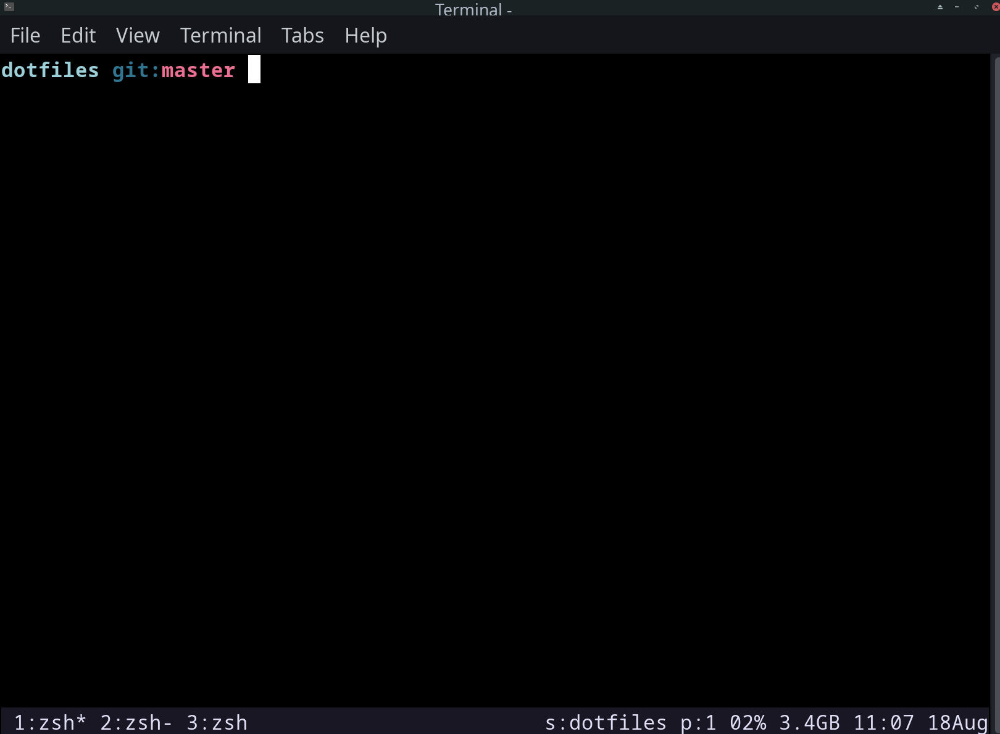
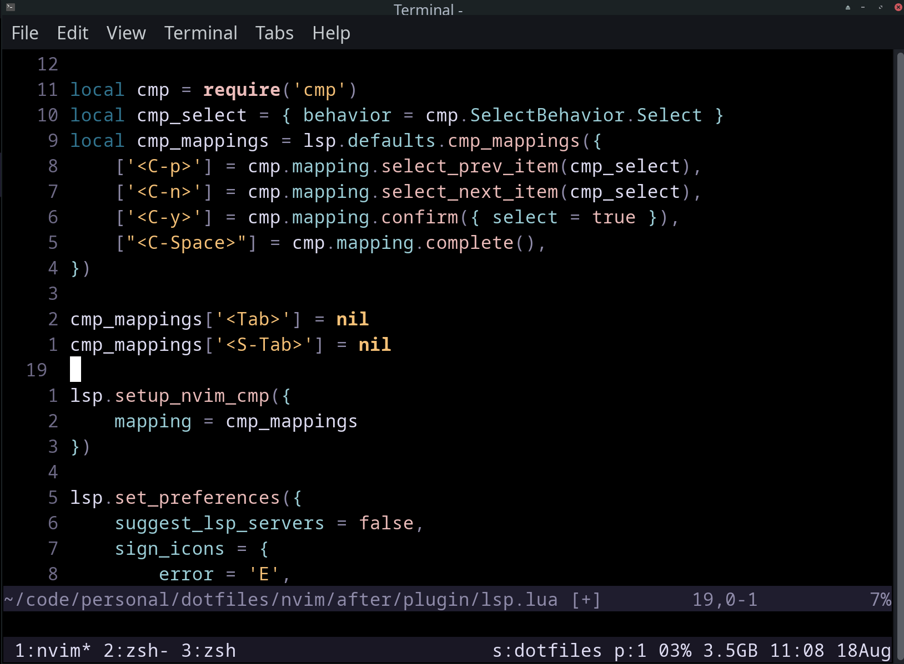
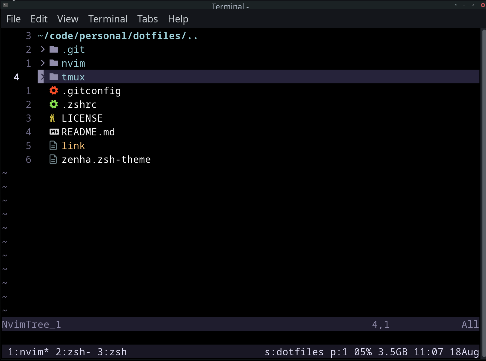

# dotfiles

- minimalistic
- [mocha theme](https://github.com/catppuccin/catppuccin)

### showcase:





- https://github.com/webpro/awesome-dotfiles
- https://github.com/ThePrimeagen/.dotfiles
- https://github.com/olimorris/dotfiles/blob/main/.config/nvim/lua/plugins/coding.lua

### Software

- nvim aur:neovim (uses lazy.nvim, self-bootstraps)
    - ripgrep
    - fzf
- gpg
- nerdfonts (Hack Nerd Font) aur:ttf-hack-nerd
- ohmyzsh
- alacritty
- mise (version manager)
- uv (python pkg manager)
- i3 (linux only)
    - playerctl
- AeroSpace (macos only)
- vpn client (differs per OS)
    - linux: eovp
    - macos: tunnelblick

See `docs/wiki/manjaroi3/fresh-install.md` for full setup.

### Structure

```
alacritty/    # terminal emulator config
aerospace/    # AeroSpace window manager config (macOS counterpart to i3/)
gnupg/        # gpg-agent.conf (per-OS pinentry-program)
i3/           # i3 window manager config (linux)
nvim/         # neovim config (lua)
agents/       # agent-neutral config shared by Claude Code and pi
tmux/         # tmux config
typst/        # long-form writing (books, TCC) — template + nvim setup
zsh/          # zsh aliases, plugins, themes
.claude/      # Claude Code settings & skills
scripts/      # utility scripts (release, commit, run, ...)
```

### pi agent

[pi](https://pi.dev) (`bun add -g @earendil-works/pi-coding-agent`) shares
Claude's setup instead of copying it. `agents/link` symlinks into `~/.pi/agent/`:

- `AGENTS.md` → `.claude/CLAUDE.md` (same global instructions)
- `mcp.json` → `agents/mcp.json` (Playwright browser, qmd vault search);
  `./link-claude` registers the same file in Claude's user scope
- `settings.json`, `models.json` → `agents/`

It also links the `wiki` and `second-brain` skills from `.claude/skills/` into
`~/.agents/skills/`, the Agent Skills dir pi reads by default.

Models are abliterated API models in `agents/models.json` (Featherless and
abliteration.ai). Keys come from env vars set in `~/.zshrc.local`:
`FEATHERLESS_API_KEY` and `ABLITERATION_API_KEY`. Switch models with
`/model` (or Ctrl+P) in a session, `pi --model abliteration/abliterated-model`
for one run, or `defaultModel` in `agents/settings.json`.

### Other

##### Pull git submodules

`git submodule update --init --recursive`
